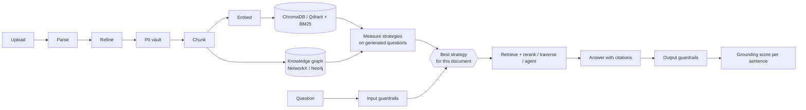
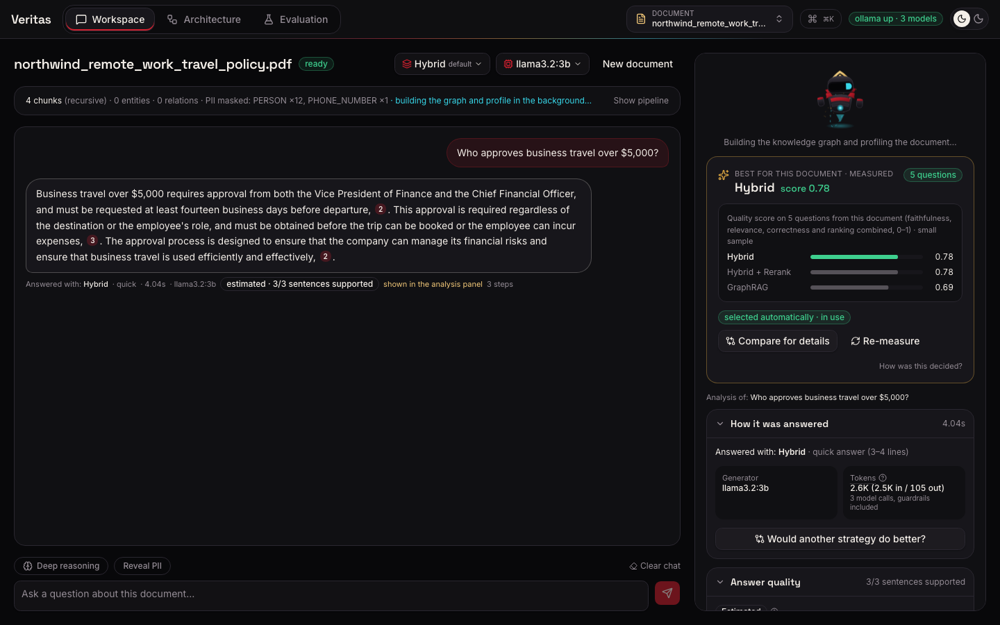
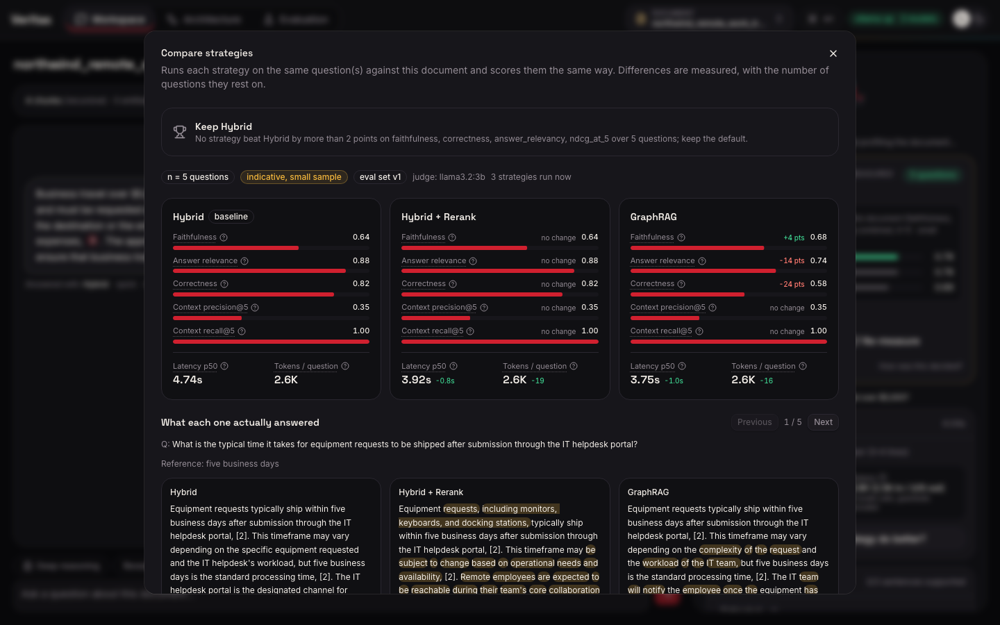
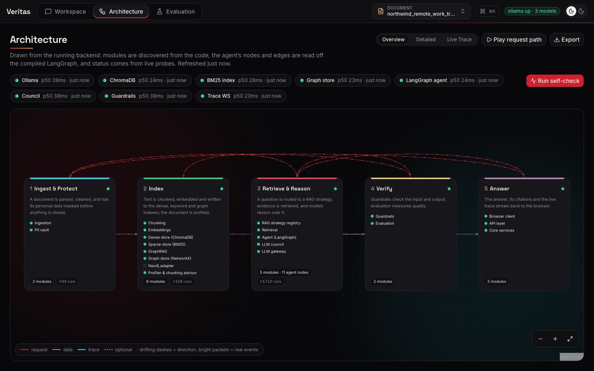
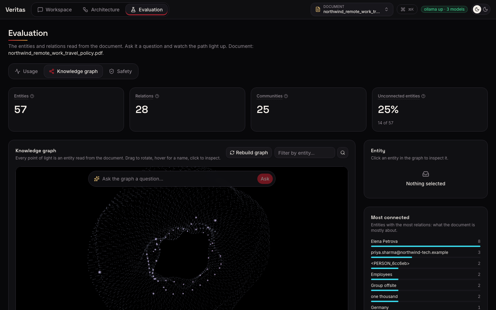
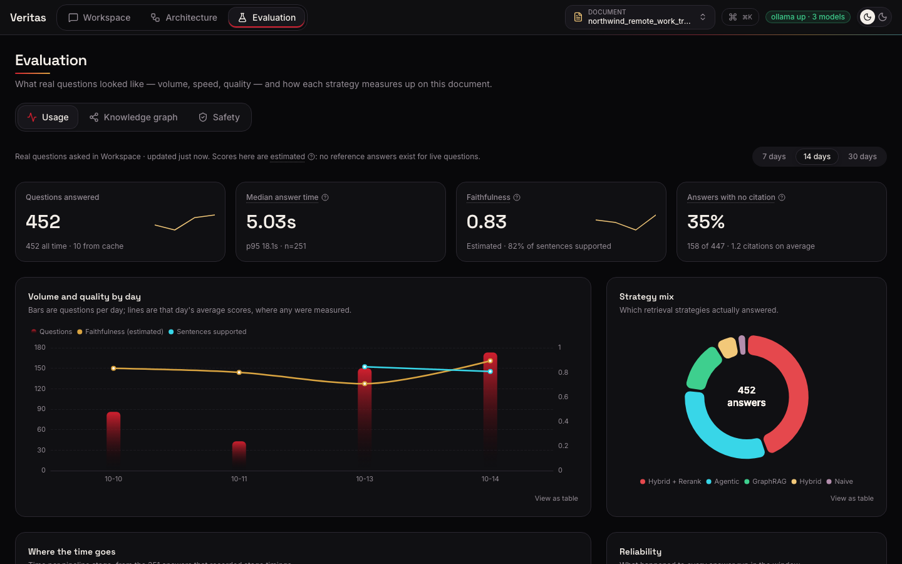
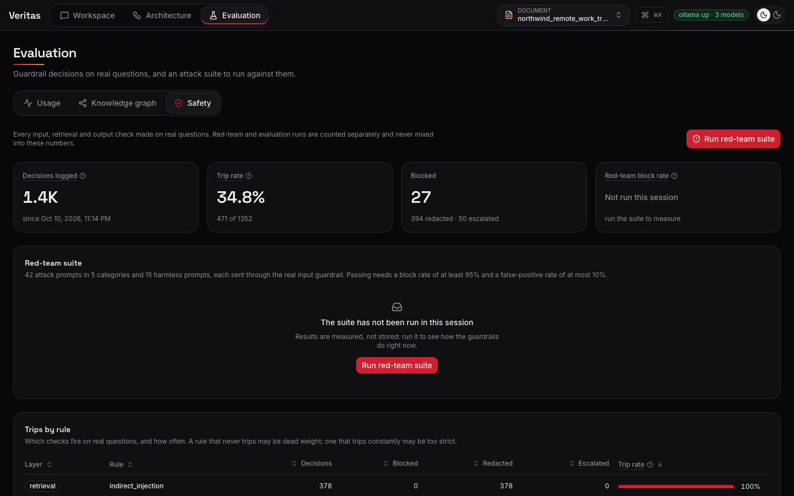

# Veritas — a dynamic hybrid RAG pipeline that picks the best strategy per document

[](https://github.com/VinayBot/veritas/actions/workflows/ci.yml)

Veritas answers questions about your own documents, with a citation on every claim, and runs
**entirely on a laptop**: local Hugging Face embeddings, ChromaDB or Qdrant (embedded), an open
cross-encoder re-ranker, NetworkX or Neo4j for the knowledge graph, local LLMs through Ollama,
Presidio PII masking and Llama Guard. Nothing leaves the machine.

Its central idea: **no single RAG strategy is best for every document.** After each upload,
Veritas writes questions with known answers from that document, runs several retrieval
strategies on them, scores every answer, and answers that document with the measured winner.
You can compare any strategy against it, question by question, with the scores side by side.

**Reviewing the assignment?** [ASSIGNMENT_REPORT.md](ASSIGNMENT_REPORT.md) maps every Week 3 topic
to what was built, where it is, and the measured evidence.

## Measured results

From `make eval` on the bundled HR handbook ([docs/BENCHMARKS.md](docs/BENCHMARKS.md); 10
generated questions per strategy, 6 for the agent; brackets are 95% bootstrap intervals):

| Strategy | Recall@5 | nDCG@5 | Faithfulness | Correctness | p95 latency | Score |
|---|---|---|---|---|---|---|
| **Hybrid + Rerank** | 1.00 | 0.99 | 0.71 (0.53–0.82) | 0.75 (0.60–0.88) | 4.2 s | **0.71** |
| GraphRAG | 1.00 | 0.99 | 0.66 (0.42–0.84) | 0.72 (0.53–0.87) | 3.9 s | 0.68 |
| HyDE | 1.00 | 0.99 | 0.66 (0.42–0.84) | 0.65 (0.43–0.85) | 6.0 s | 0.65 |
| Hybrid | 1.00 | 1.00 | 0.62 (0.40–0.80) | 0.63 (0.42–0.83) | 7.8 s | 0.62 |
| Agentic | 1.00 | 1.00 | 0.53 (0.23–0.83) | 0.60 (0.33–0.87) | 15.7 s | 0.54 |

Hybrid retrieval finds the right passage every time (Recall@5 1.00); the differences are in
generation, and they are small next to the noise. The intervals overlap; the agent's
faithfulness, measured on six questions, ranged from 0.53 to 0.87 across runs; and a second
judge from another model family agreed with the first on 76% of correct/incorrect verdicts but
no better than chance once their base rates are accounted for (Cohen's κ 0.00). So the app
does not trust one benchmark: it measures each document on its own questions, shows the
sample size and intervals, and lets you compare. Hybrid + Rerank leads on this document at a
quarter of the agent's latency; no strategy cleared the 0.85 faithfulness gate in this run.

Safety on the same run: **42/42** red-team attacks blocked with no false positives, **0** PII
values in the indexed chunks; PII detection measures precision 0.97, recall 1.00 on a labelled
set in four languages (`make pii-eval`).

## Quickstart

```bash
# Prerequisites: Python 3.11 + uv, Node 22, Ollama (https://ollama.com)
ollama pull llama3.2:3b          # answer model (about 2 GB)
ollama pull llama-guard3:1b      # safety classifier
ollama pull gemma2:2b            # optional: second judge in make eval, and the Council strategy

make setup                        # backend (uv sync), .env with this install's own PII keys, frontend (npm install)
make dev                          # API on :8000, UI on http://localhost:5173/app
```

Then upload a document (or click **Or try the bundled sample**) and ask a question. Other
targets: `make test`, `make lint`, `make eval` (publishes [docs/BENCHMARKS.md](docs/BENCHMARKS.md)),
`make redteam`, `make pii-eval`, `make planner-eval`. Docker: run `make setup` once (it writes
`.env` with the PII keys), then `docker compose up`; the optional `qdrant` and `neo4j` profiles start
those servers (set `QDRANT_URL` / `GRAPH_STORE=neo4j` to use them).

## Assignment topics and where each one lives

| Day | Topic | What is implemented | Code | Tests |
|---|---|---|---|---|
| 11 | **Custom parsers, legacy formats** | One parser registry: Docling (PDF layout, DOCX, PPTX, XLSX, images with OCR), trafilatura (HTML), EML, RTF, CSV/TXT/MD, and legacy binary **.doc/.xls** through headless LibreOffice; an SSRF-guarded URL scraper; a text-quality refiner | `app/ingestion/` | `test_parsers_formats.py` (incl. OCR of a scanned page), `test_registry.py`, `test_refiner.py`, `test_scraper_ssrf.py`, `test_golden_retrieval.py` |
| 11 | **Chunking** | Six strategies: fixed, recursive, sentence-window, semantic, structure-aware, parent-child; a chunking tournament picks the best per document | `app/chunking/`, `app/profiler/tournament.py` | `test_chunking.py`, `test_semantic_chunking.py`, `test_profiler_tournament.py` |
| 11 | **Vector DBs and hybrid search** | Local `all-MiniLM-L6-v2` embeddings; **ChromaDB and Qdrant** behind one interface (`VECTOR_STORE`); BM25 (bm25s) + dense fused with Reciprocal Rank Fusion | `app/stores/vector/`, `app/retrieval/hybrid.py` | `test_vector_stores.py` (identical hits and scores from both stores), `test_hybrid_retrieval.py`; CI runs the retrieval suite on Qdrant too |
| 12 | **Re-ranking** | Cross-encoder `ms-marco-MiniLM-L-6-v2` over the fused candidates | `app/retrieval/reranker.py` | `test_reranker.py` |
| 12 | **Query rewriting, HyDE** | HyDE (embed a hypothetical answer); the agent's rewriter tries several rewrite techniques when the critic finds evidence insufficient | `app/retrieval/hyde.py`, `app/agents/rewriter.py`, `app/agents/critic.py` | `test_hyde.py`, `test_agents_critic.py`, `test_agents_graph.py` |
| 12 | **Context deduplication and compression** | MMR, cosine-threshold and n-gram dedup; extractive compression to a token budget; a semantic cache | `app/retrieval/dedupe.py`, `compression.py`, `semantic_cache.py` | `test_dedupe.py`, `test_compression.py`, `test_semantic_cache.py` |
| 12 | **Advanced RAG** | Eight strategies in one registry (Naive, Hybrid, Hybrid + Rerank, HyDE, Semantic chunks, GraphRAG, Agentic, Council); Agentic is a LangGraph state machine: planner, rewriter, retriever, critic, synthesizer, verifier, guardian. The planner can use the model's native tool calling (`PLANNER_MODE=tool_call`); the JSON prompt is the default because it routed 13/16 labelled questions correctly against 10/16 (`make planner-eval`) | `app/rag_engines/`, `app/agents/`, `app/council/` | `test_rag_api.py`, `test_agents_*.py`, `test_council.py` |
| 13 | **Entity extraction** | spaCy NER, PII tokens kept as entities, deterministic entity resolution; relations two ways: entities in the same sentence are linked in every chunk (no model needed), and typed triples are read by the LLM from up to 20 chunks (tolerant parsing) | `app/graphrag/extractor.py`, `resolver.py`, `service.py` | `test_graphrag_extractor*.py`, `test_graphrag_resolver.py`, `test_graph_co_occurrence.py` |
| 13 | **Graph store and traversal** | **NetworkX and Neo4j** behind one interface (`GRAPH_STORE`); fuzzy entity linking from the question; n-hop traversal; Louvain communities with summaries; "Ask the graph" in the UI | `app/stores/graph/`, `app/graphrag/service.py` | `test_graph_store_parity.py` (both stores; CI runs a real Neo4j), `test_graphrag_service.py`, `test_graph_api.py` |
| 14 | **Synthetic dataset generation** | Questions with known answers written from the document's own chunks: factoid, multi-hop, comparison, unanswerable and PII; deduplicated by embedding; each keeps its source chunk ids | `app/evaluation/datasets.py` | `test_evaluation_api.py` |
| 14 | **Precision/recall, faithfulness** | Precision@5, Recall@5, MRR, nDCG@5 against the source chunks; judge-model faithfulness, relevancy and correctness; judge-free answer F1; 95% bootstrap confidence intervals; a second judge from another model family re-scores correctness to measure agreement; per-sentence grounding shown under each answer | `app/evaluation/metrics/`, `judge.py`, `stats.py`, `agreement.py`, `grounding.py` | `test_eval_retrieval_metrics.py`, `test_eval_judge.py`, `test_grounding*.py`; `test_golden_retrieval.py`: 31 hand-written questions over four real documents (incl. French and a 61-page handbook), each answer's verbatim evidence must be in the top 5 |
| 14 | **Benchmarking and production selection** | Every strategy on the same questions; hard gates (faithfulness ≥ 0.85, injection block rate ≥ 95%, zero PII leaks, p95 ≤ 15 s) then a weighted score; per-document automatic selection; side-by-side comparison with caching | `app/evaluation/benchmark.py`, `app/rag_engines/compare.py`, `document_strategy.py` | `test_evaluation_benchmark.py`, `test_rag_compare.py`, `test_document_strategy.py` |
| 15 | **Input/output validation, content filtering** | Input: length, encoding/obfuscation checks, injection detection, Llama Guard. Retrieval: indirect-injection scan of retrieved chunks. Output: PII leak redaction, secret/system-prompt leak block, Llama Guard, mandatory citations | `app/guardrails/` | `test_guardrails_*.py` |
| 15 | **PII detection (Presidio NER)** | Presidio + spaCy with custom recognizers (given names, any-domain emails, Aadhaar, PAN), a multilingual model for non-English documents; HMAC tokens before chunking, so embeddings, indexes, graph and LLM never see raw PII; Fernet-encrypted vault with an audited reveal. Measured on 40 hand-labelled sentences in four languages: precision 0.97, recall 1.00 (`make pii-eval`) | `app/privacy/` | `test_pii.py`, `test_pii_eval.py`, `test_guardrails_output.py` |
| 15 | **Prompt-injection defence, Llama Guard** | Regex heuristics (including persona overrides), the `protectai/deberta-v3-base-prompt-injection-v2` classifier and `llama-guard3:1b`; untrusted-context delimiting in every prompt; a 42-attack / 15-benign red-team suite: 42/42 blocked, 0 false positives, with a CI gate (block rate ≥ 95%, false positives ≤ 10%) | `app/guardrails/injection.py`, `llama_guard.py`, `redteam/` | `test_guardrails_injection.py`, `test_redteam.py`; `make redteam` |

## How a question is answered



The **Workspace** tab shows each ingestion stage live, the recommended strategy with its
measured scores, and answers that stream in with citation chips; unsupported sentences are
underlined in red. **Architecture** draws the system from the code (packages, the compiled
LangGraph) and animates real trace events. **Evaluation** has Usage (volume, quality, latency
per stage, measured benchmark results), the **Knowledge graph** (explore it, or ask it a
question and watch the traversal) and **Safety** (every guardrail decision, the audit log and
the red-team suite). See [docs/USAGE.md](docs/USAGE.md).

## Screenshots

| Workspace: a cited answer, its grounding, and the strategy measured best for this document | Compare: every strategy on the same questions, scores side by side |
|---|---|
|  |  |
| **Architecture: drawn from the code, with live health probes** | **Knowledge graph: entities and relations; ask it a question** |
|  |  |
| **Evaluation: usage, quality and latency from real questions** | **Safety: every guardrail decision and the red-team suite** |
|  |  |

## Engineering

- **CI** (`.github/workflows/ci.yml`, six jobs): ruff, ruff format, mypy on `app/`, the pytest
  suite, the retrieval suite again on Qdrant, the whole suite again on PostgreSQL, graph-store
  parity against a real Neo4j and shared rate limits against a real Redis (service
  containers), the red-team gate, and the frontend's lint (zero warnings), unit tests and
  production build. Tests that call a local model are marked `needs_ollama` and skipped with
  a reason where Ollama is absent: without it, 437 pass at 81% line coverage; with it, every
  test runs for real.
- **Access control**: optional API keys with viewer / analyst / admin roles, enforced on every
  route from one policy table (`app/core/auth.py`, `AUTH_ENABLED`); rate limits per session
  and per client address, shared through Redis when configured.
- **Databases**: SQLite by default, PostgreSQL with `DATABASE_URL` (both tested in CI).
- **End-to-end**: 32 Playwright tests drive the real UI against the real backend and models
  (`frontend/tests/e2e/`).
- **Typed throughout**: Pydantic v2 models at every API boundary; TypeScript strict frontend
  with a typed API client.
- **Observability**: every pipeline stage emits a trace event (WebSocket `/ws/trace`), and
  latency per stage is recorded and charted.
- **Memory-aware**: designed for a 16 GB laptop; only the answer and guard models stay loaded,
  everything else is unloaded after use (see `HARDWARE_TIER` in `.env.example`).

## Stack

Backend: FastAPI, LangGraph, LiteLLM (Ollama by default), sentence-transformers, bm25s,
ChromaDB / Qdrant, NetworkX / Neo4j, spaCy, Docling, trafilatura, Presidio, transformers,
SQLAlchemy (async, SQLite). Frontend: Vite, React 19, TypeScript, Tailwind v4, Framer Motion,
@xyflow/react, react-force-graph-2d, ECharts, Zustand, Playwright, Vitest.

## Repo layout

```
backend/app/       api, core, ingestion, privacy, chunking, embeddings, stores, retrieval,
                   graphrag, agents, council, rag_engines, guardrails, profiler, evaluation, llm
backend/scripts/   run_eval.py (make eval), run_redteam.py (make redteam), doctor.py
backend/tests/     pytest suite: real pipelines and real local models, no mocked backend logic
frontend/src/      pages (landing, Workspace, Architecture, Evaluation), components, hooks,
                   typed API client (REST, SSE, WebSocket), Zustand store
frontend/tests/    Vitest unit tests and Playwright end-to-end tests
docs/              ARCHITECTURE, API, USAGE, EVALUATION, BENCHMARKS, GUARDRAILS,
                   TROUBLESHOOTING, DECISIONS (every non-obvious choice and why)
```

## Limitations

- Local 3B models are fast enough for a laptop but weaker judges than large hosted models;
  scores carry their sample size and confidence interval, and a second judge's agreement is
  reported.
- The Agentic and Council strategies take 15–40 s per answer on a laptop, so they are
  recommended when they measure best but never switched to automatically.
- Access control is off by default because the app is a local, single-user tool; turn on
  `AUTH_ENABLED` before exposing it on a network.

See [docs/TROUBLESHOOTING.md](docs/TROUBLESHOOTING.md) for setup problems.
